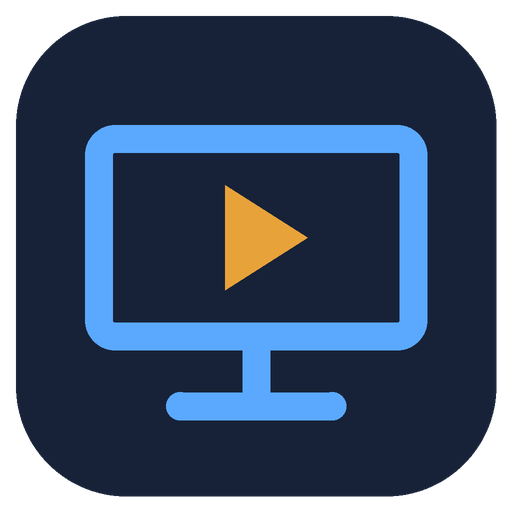

# TeleTV

**Android TV, in a Windows app.**

Open TeleTV and you're looking at a real Android TV home screen. Install APKs from your PC with a drag and drop,
download apps with the built-in Downloader, and drive it all with the keyboard, the mouse or a TV remote.
For Windows 10 and 11.

**[Download TeleTV for Windows](https://github.com/bhxuk/TeleTV/releases/latest/download/TeleTV-Setup.exe)**  ·  [Website](https://bhxuk.github.io/TeleTV/)  ·  [User guide](docs/USER-GUIDE.md)  ·  [What's new](CHANGELOG.md)

---

## What it does

| | |
|---|---|
| **A real Android TV** | Google TV with the Play Store (or plain Android TV if you prefer), running in a normal resizable window. F11 for full screen. |
| **Import APK** | Drag APK files onto the window, or browse for them. They install straight into Android and open. `.apks` and `.xapk` bundles work too. |
| **Downloader** | A browser built into TeleTV. Type a web address or a direct APK link; when an app finishes downloading, press Install. |
| **Apps** | See everything you've added, open it, stop it, clear its data or uninstall it. |
| **Double-click an APK** | In File Explorer, double-click any `.apk` and it installs in TeleTV. |
| **Quick start** | TeleTV saves where you were when it closes, so it opens in seconds next time. |
| **Updates built in** | TeleTV updates itself from this page's releases, and keeps Android up to date from Google, all from Settings > Updates. |

## Install

1. Download **[TeleTV-Setup.exe](https://github.com/bhxuk/TeleTV/releases/latest/download/TeleTV-Setup.exe)** and double-click it. No admin rights needed.
2. Open TeleTV. The first time, it downloads Android TV straight from Google (about 2 GB) and asks you to accept Google's licence for it.
3. That's it. If your PC needs Windows Hypervisor Platform switched on, TeleTV does it for you and asks for one restart.

Windows may show "Windows protected your PC" because the installer isn't code-signed. Click **More info** and then **Run anyway**.

## What you need

- Windows 10 (version 2004 or later) or Windows 11, 64-bit
- A processor with virtualisation (Intel VT-x or AMD-V), switched on in the BIOS. Almost every PC from the last ten years has it.
- 8 GB of memory or more is best. 16 GB is comfortable.
- About 10 GB of free space for Android and your apps

## Controls

| Key | Does |
|---|---|
| Arrow keys | Move, like a remote's D-pad |
| Enter | Select |
| Esc | Back |
| Home | Android TV home screen |
| F11 | Full screen on and off |
| Ctrl+V | Paste text from Windows into Android |

Mouse clicks, the scroll wheel and Bluetooth TV remotes work too. More in the [user guide](docs/USER-GUIDE.md).

## Good to know

- Apps that need Google's certified-device checks for DRM (Netflix, Prime Video, Disney+ and similar) don't run properly in any Android emulator, TeleTV included.
- Some apps are built only for ARM phones and won't install. TeleTV tells you when that happens.
- Android, the emulator and adb come directly from Google's servers under the Android SDK licence. TeleTV doesn't bundle or change them.

## Building it yourself

TeleTV is a .NET 8 WPF app. `dotnet build src/TeleTV/TeleTV.csproj` builds it on Windows. Pushing to `main` builds `TeleTV-Setup.exe` with GitHub Actions and publishes a release when the version in `TeleTV.csproj` changes.

## Licence

MIT. Android, Android TV, Google TV and Google Play are trademarks of Google LLC. TeleTV isn't made by or affiliated with Google.
